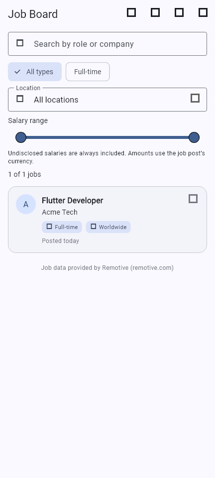
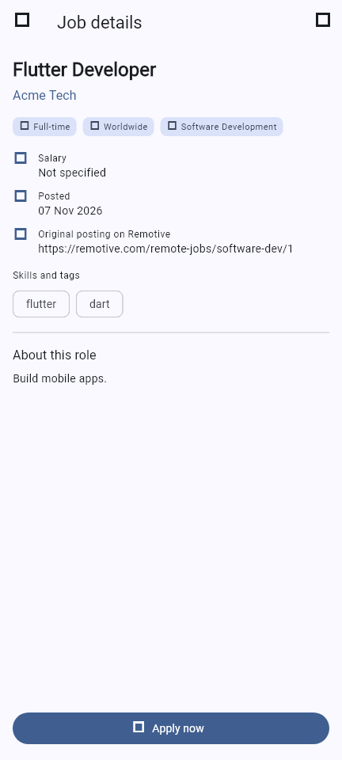
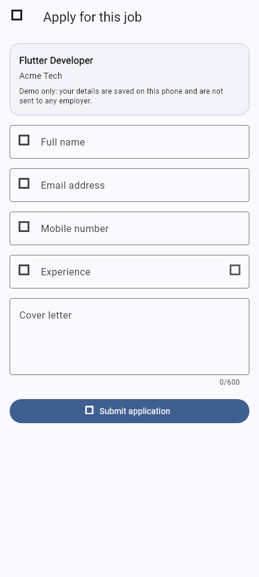

# Job Board

**Topic:** Job board

## Description

Job Board helps job seekers browse remote job openings, search and filter them,
read the full details of a role, and fill in a validated application form.
Applications and appearance preferences are saved on the device. Users can
also create a local account to protect access to their application data.

## Screenshots

These UI captures use a sample job listing.

| Job list | Job details | Application form |
|---|---|---|
|  |  |  |

## Data source

- **Job listings:** [Remotive public API](https://github.com/remotive-com/remote-jobs-api)
  (`https://remotive.com/api/remote-jobs`). No API key is needed, so nothing
  secret is stored in this repository. Remotive is credited in the app and
  each job links back to its Remotive page.
- **Applications:** created by the user and saved on the device with
  `shared_preferences`, so they survive a restart.
- **Account:** one local profile per device. The password itself is never
  stored; a salted verifier is kept in Android secure storage. This demo
  profile does not sync or authenticate against an online service.
- **Cache:** job listings are kept on the device for one hour to avoid calling
  the API too often (Remotive asks apps to fetch only a few times a day).

## Features

- Browse remote jobs with search, job-type, location, and salary filters
- View job descriptions, salary details, tags, and links to the original listing
- Submit a validated application form and edit saved applications
- Track applications as Applied, Interview, Offer, or Rejected
- View application statistics and recently viewed jobs
- Create a local profile and sign in; password verifiers use secure storage
- Choose system, light, or dark appearance in Settings
- Refresh job listings from the Remotive API, with a one-hour local cache
- Loading, retryable error, empty, and populated job-list states

## Project structure

```
lib/
  main.dart
  models/       Job, JobApplication, UserProfile
  services/     API, storage, local authentication, validators, date formatting
  providers/    JobProvider, ApplicationProvider, AuthProvider (ChangeNotifier)
  screens/      login, job list/detail, applications, statistics, settings
  widgets/      job card, filter bar, loading / error / empty views, chip
  theme/        AppTheme (the only place a colour is defined)
test/           widget tests and validator tests
```

## Requirements

- Flutter stable 3.35 or newer with Dart null safety
- Android Studio with the Flutter and Dart plugins
- JDK 17 and an Android emulator or physical Android phone

## Run and test

From a fresh clone:
```bash
git clone https://github.com/pardhu1506/Job_board.git
cd Job_board
flutter pub get
flutter run                         # Android emulator or connected phone
flutter test                        # widget and unit tests
flutter build apk --release         # build the release APK
```

The APK is created at `build/app/outputs/flutter-apk/app-release.apk`. Install
it on an Android phone with:

```bash
adb install -r build/app/outputs/flutter-apk/app-release.apk
```

To download the prebuilt Android app, download
[JobBoard-Android.apk](downloads/JobBoard-Android.apk) to your phone and open
it to install.

## Team

The project specification requires two or three named members and each
member's owned screen or major component. Team details have not been provided
yet; complete this table before submission. The current repository history
shows commits from the account `pardhu1506`; ensure every team member also
contributes regular commits.

| Member | Screen or major component owned |
|---|---|
| To be provided | To be provided |
| To be provided | To be provided |

## Defect log

See [DEFECT_LOG.md](DEFECT_LOG.md) for automated results and physical-device
checks that remain to be completed.

## Credits

Job data by [Remotive](https://remotive.com).
